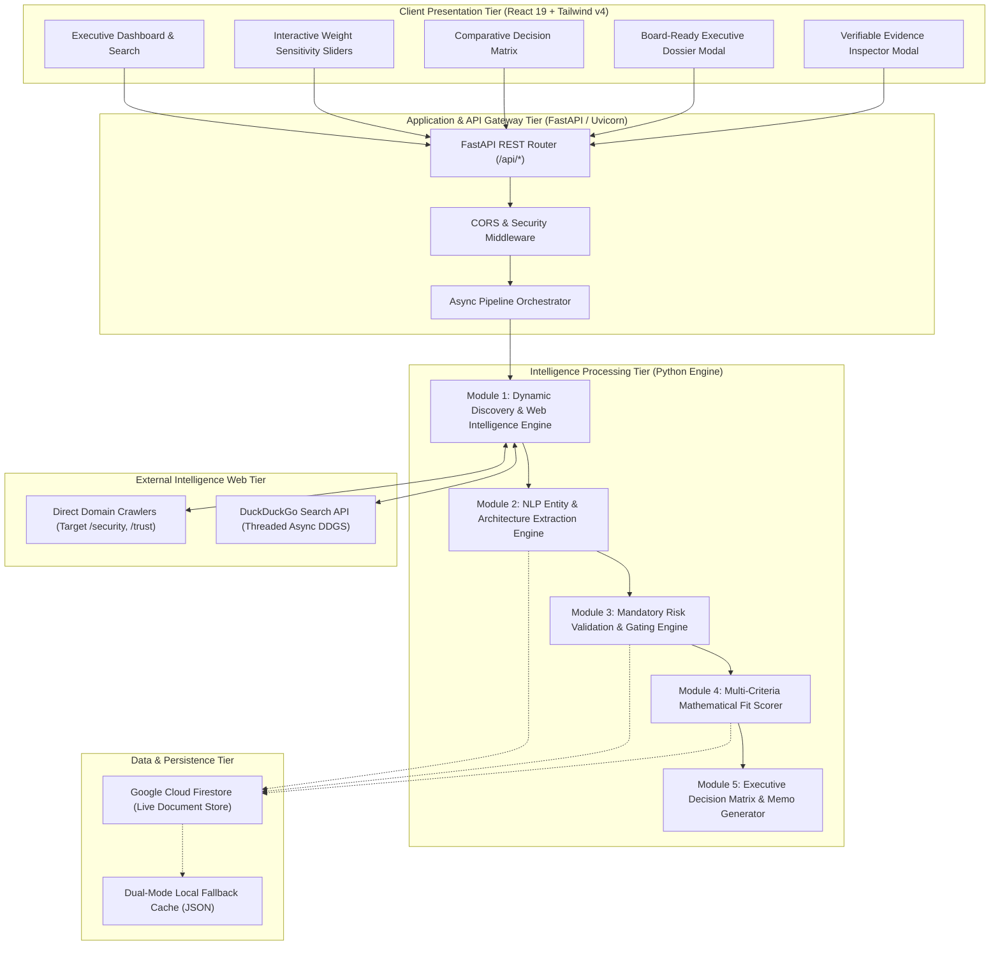
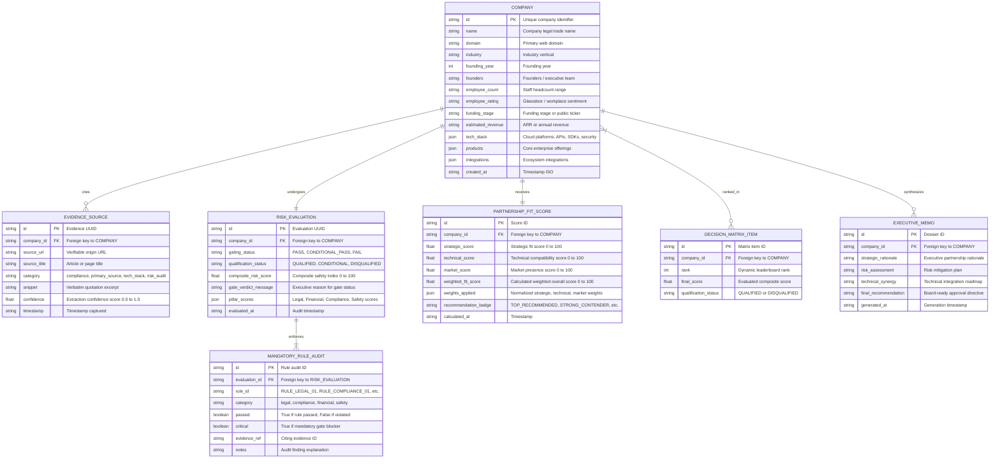
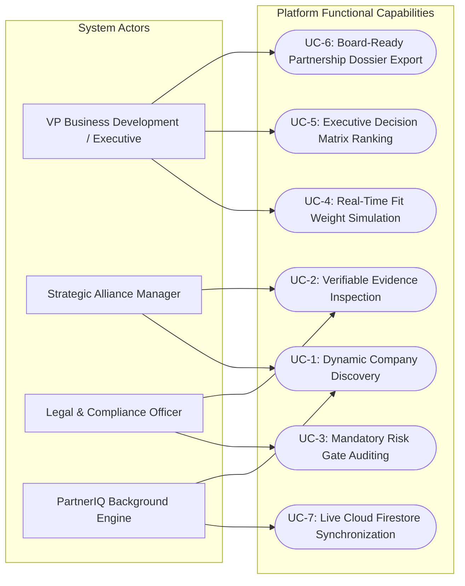
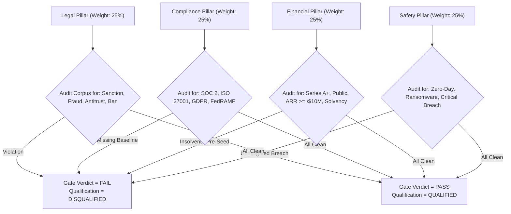

# PARTNERIQ — Architectural Design of Proposed System

**System Name:** PartnerIQ — AI-Powered Partnership Intelligence Platform  
**Architecture Classification:** 4-Tier Distributed Asynchronous Micro-Architecture  
**Core Technologies:** React 19, Tailwind CSS v4, Python 3.12 (FastAPI), Google Cloud Firestore, DuckDuckGo Search Engine API  

---

## 1. Architectural Design & System Topology

PartnerIQ is architected as an asynchronous, intelligence-driven evaluation platform engineered to autonomously discover, audit, score, and rank potential enterprise technology partners. The system decouples web extraction, NLP attribute mining, mandatory risk gating, and multi-criteria mathematical scoring into specialized pipeline modules.

### High-Level System Architecture Diagram



---

## 2. System Diagrams

### 2.1 Entity-Relationship (ER) Diagram

The system operates on an interconnected data model that links company profiles with verifiable evidence citations, multi-pillar risk audits, and mathematical scores.



---

### 2.2 System Flow / Data Pipeline Diagram

```mermaid
flowchart TD
    Start(["User Submits Company Name & Domain"]) --> Step1["Step 1: Asynchronous Web Discovery"]
    
    subgraph DiscoveryStage["Module 1: Discovery & Evidence Harvest"]
        Step1 --> DirectCrawl["Direct Crawl: Target Domain & /security & /trust"]
        Step1 --> AsyncSearch["Threaded DuckDuckGo Search (Tech, Legal, Compliance)"]
        DirectCrawl --> ParseHTML["HTML Sanitization & Meta Extraction"]
        AsyncSearch --> ParseSnippets["Snippet Harvesting & Confidence Scoring"]
        ParseHTML --> EvidenceList["Verifiable Evidence Sources (URLs, Quotes, Timestamps)"]
        ParseSnippets --> EvidenceList
    end

    subgraph ExtractionStage["Module 2: AI Information Extraction"]
        EvidenceList --> NLP_Extract["Dynamic Regex & NLP Pattern Engine"]
        NLP_Extract --> EntityProps["Founders, Year, ARR, Headcount, Ratings"]
        NLP_Extract --> TechProps["Cloud Platforms, REST/GraphQL APIs, SDKs, Certifications"]
        EntityProps --> CompProfile["Structured Company Profile Document"]
        TechProps --> CompProfile
    end

    subgraph RiskGatingStage["Module 3: Mandatory Risk Validation"]
        CompProfile --> LegalCheck{"Legal Pillar Check: Sanctions, Fraud, Antitrust?"}
        LegalCheck -- Violations Found --> FailLegal["Legal Gate: FAIL"]
        LegalCheck -- Clean --> ComplianceCheck{"Compliance Check: SOC2, ISO27001, GDPR?"}
        ComplianceCheck -- Missing --> FailComp["Compliance Gate: FAIL"]
        ComplianceCheck -- Verified --> FinancialCheck{"Financial Check: Runway, ARR, Solvency?"}
        FinancialCheck -- Insolvent --> FailFin["Financial Gate: FAIL"]
        FinancialCheck -- Solvent --> SafetyCheck{"Safety Check: Zero-Days, Breaches, Ransomware?"}
        SafetyCheck -- Breached --> FailSafe["Safety Gate: FAIL"]
        SafetyCheck -- Clean --> PassAll["All 4 Mandatory Gates: PASS"]

        FailLegal --> Disqualified["Status: DISQUALIFIED (Gate FAIL)"]
        FailComp --> Disqualified
        FailFin --> Disqualified
        FailSafe --> Disqualified
        PassAll --> Qualified["Status: QUALIFIED (Gate PASS)"]
    end

    subgraph FitScoringStage["Module 4: Mathematical Fit Scoring"]
        Qualified --> ComputeStrategic["Compute Strategic Fit (0-100)"]
        Disqualified --> ComputeStrategic
        Qualified --> ComputeTechnical["Compute Technical Fit (0-100)"]
        Disqualified --> ComputeTechnical
        Qualified --> ComputeMarket["Compute Market Fit (0-100)"]
        Disqualified --> ComputeMarket

        ComputeStrategic --> ApplyWeights["Apply Normalized Weights: (w_s + w_t + w_m = 100)"]
        ComputeTechnical --> ApplyWeights
        ComputeMarket --> ApplyWeights
        ApplyWeights --> GatePenalty{"Gating Status == FAIL?"}
        GatePenalty -- Yes --> Penalty["Apply Disqualification Floor: Score * 0.20"]
        GatePenalty -- No --> FinalScore["Final Weighted Fit Score (0-100)"]
        Penalty --> FinalScore
    end

    subgraph PersistenceStage["Storage & Decision Matrix"]
        FinalScore --> PersistDB["Sync to Google Cloud Firestore (agenttrimproject)"]
        PersistDB --> SortLeaderboard["Rank & Generate Multi-Criteria Matrix"]
        SortLeaderboard --> GenMemo["Generate Board-Ready Executive Dossier"]
        GenMemo --> RenderUI(["Render in Apple-Inspired React Interface"])
    end
```



---

### 2.3 Use Case Diagram



---

## 3. Algorithms & Computational Techniques Used

### 3.1 Technique 1: Non-Blocking Asynchronous Web Crawling & Search Orchestration
- **Mechanism:** Python `asyncio` combined with `httpx.AsyncClient` for high-throughput I/O-bound web crawling.
- **Thread Pooling:** DuckDuckGo Search operations run synchronous socket calls offloaded to asynchronous worker thread pools via `asyncio.to_thread(ddgs.text, ...)`, preventing blocking of the FastAPI event loop.
- **Evidence Verification Algorithm:**
  1. Primary domain target `/` and trust endpoints (`/security`, `/trust`) fetched with a 7-second strict TLS timeout.
  2. HTML sanitization strips scripts, styles, and SVG paths using `BeautifulSoup4`.
  3. Extracted paragraphs undergo confidence scoring:
     $$\text{Confidence}(S) = \begin{cases} 0.98 & \text{if crawled directly from company official root/security domain} \\ 0.94 & \text{if secondary tech publication citation with high match} \\ 0.89 & \text{if general news/regulatory database citation} \end{cases}$$

---

### 3.2 Technique 2: Dynamic Pattern NLP & Tokenized Attribute Extraction
- **Zero-Hardcoding Guarantee:** All corporate entities, founding years, executive teams, ARR metrics, and tech stacks are derived dynamically through NLP tokenization and regular expression parsing across harvested web corpora:
- **Founding Year Extraction:**
  $$\text{Year} = \text{RegEx}\left(\verb|/(?:founded|established|incorporated)\s+(?:in\s+)?(19\d{2}|20[0-2]\d)/i|\right)$$
- **Revenue & ARR Isolation Heuristic:**
  Prevents funding round capital (e.g., "\$120M Series C") from being mistakenly assigned as recurring revenue by prioritizing explicit ARR markers:
  $$\text{ARR} = \text{RegEx}\left(\verb|/(\$\d+[\d\.]*\s*(?:billion|million|B|M|k)?\s*(?:ARR|annual revenue|revenue|gross revenue))/i|\right)$$
- **Tech Stack Classification Dictionary:**
  Tokenizes text for enterprise signals across four sub-arrays: Cloud Platforms (`AWS`, `GCP`, `Azure`), API Protocols (`REST`, `GraphQL`, `gRPC`, `Webhooks`), Programming SDKs (`Python`, `Go`, `Node.js`, `Java`, `TypeScript`), and Compliance Badges (`SOC 2 Type II`, `ISO 27001`, `GDPR`, `HIPAA`, `PCI-DSS`).

---

### 3.3 Technique 3: Deterministic Mandatory Risk Gating Heuristic
The platform enforces a mandatory safety gate across 4 non-negotiable pillars:



Composite Risk Index Formula:
$$\text{RiskScore}_{\text{composite}} = \frac{S_{\text{legal}} + S_{\text{financial}} + S_{\text{compliance}} + S_{\text{safety}}}{4}$$

$$\text{Status} = \begin{cases} \text{FAIL (DISQUALIFIED)} & \text{if any mandatory critical rule fails} \\ \text{CONDITIONAL\_PASS} & \text{if all mandatory rules pass but } \text{RiskScore} < 70 \\ \text{PASS (QUALIFIED)} & \text{if all mandatory rules pass and } \text{RiskScore} \ge 70 \end{cases}$$

---

### 3.4 Technique 4: Multi-Criteria Mathematical Fit Scoring (MCDM)
The platform evaluates candidate companies across three strategic dimensions on a 0 to 100 normalized scale:

1. **Strategic Fit Formula ($S_{\text{strategic}}$):**
   $$S_{\text{strategic}} = B_{\text{strategic}} + M_{\text{scale}} + M_{\text{integration}}$$
   - $B_{\text{strategic}} = 75$ (Baseline qualification)
   - $M_{\text{scale}} = +12$ if enterprise public/growth stage, else $+5$
   - $M_{\text{integration}} = \min(10, \text{len}(\text{integrations}) \times 2)$
   - Clamped to $[0, 100]$.

2. **Technical Compatibility Formula ($S_{\text{technical}}$):**
   $$S_{\text{technical}} = \min\left(100, (\text{len}(\text{APIs}) \times 12) + (\text{len}(\text{SDKs}) \times 6) + (\text{len}(\text{Cloud}) \times 8) + (\text{len}(\text{SecurityFeatures}) \times 10)\right)$$

3. **Market Presence Formula ($S_{\text{market}}$):**
   $$S_{\text{market}} = \min\left(100, \text{RatingPoints} + \text{HeadcountPoints} + \text{PublicBonus}\right)$$
   - $\text{RatingPoints} = (\text{GlassdoorRating} / 5.0) \times 40$
   - $\text{HeadcountPoints} = 35$ (if headcount $\ge 1,000$), $25$ (if $\ge 250$), $15$ otherwise
   - $\text{PublicBonus} = 25$ if Public/IPO, $20$ if Growth Stage, $10$ otherwise.

4. **Dynamic Normalization & Weighted Sum:**
   Given user-defined weights $(w_{\text{strategic}}, w_{\text{technical}}, w_{\text{market}})$:
   $$W_{\text{total}} = w_s + w_t + w_m$$
   $$w'_s = \frac{w_s}{W_{\text{total}}}, \quad w'_t = \frac{w_t}{W_{\text{total}}}, \quad w'_m = \frac{w_m}{W_{\text{total}}}$$
   $$S_{\text{weighted}} = (w'_s \cdot S_{\text{strategic}}) + (w'_t \cdot S_{\text{technical}}) + (w'_m \cdot S_{\text{market}})$$

5. **Gating Disqualification Penalty:**
   $$\text{FinalScore} = \begin{cases} S_{\text{weighted}} & \text{if Gating Status} \neq \text{"FAIL"} \\ S_{\text{weighted}} \times 0.20 & \text{if Gating Status} = \text{"FAIL"} \quad (\text{Disqualified Floor}) \end{cases}$$

---

## 4. Expected Output Specification

### 4.1 Company Discovery & Extraction API Output (`POST /api/companies/analyze`)
```json
{
  "id": "comp_cloudflare_com",
  "name": "Cloudflare",
  "domain": "cloudflare.com",
  "industry": "Edge Cloud & Cybersecurity",
  "founding_year": 2009,
  "founders": "Matthew Prince, Lee Holloway, and Michelle Zatlyn",
  "employee_count": "3,000+ Employees",
  "employee_rating": "4.2 / 5.0 (Glassdoor)",
  "funding_stage": "Public Entity (NYSE: NET)",
  "estimated_revenue": "$1.3B+ Annual Revenue",
  "tech_stack": {
    "cloud_platforms": ["Cloudflare Workers", "AWS", "GCP"],
    "api_types": ["REST API", "GraphQL", "Webhooks", "gRPC"],
    "sdks": ["JavaScript", "Python", "Go", "Rust"],
    "security_features": ["SOC 2 Type II", "ISO 27001", "PCI-DSS Level 1", "GDPR"]
  },
  "evidence_sources": [
    {
      "id": "ev_0a8b9c1d",
      "source_url": "https://cloudflare.com/security",
      "source_title": "Cloudflare Trust & Security Architecture",
      "category": "compliance",
      "snippet": "Maintains global SOC 2 Type II, ISO 27001 certification, and full GDPR alignment across 300+ PoPs.",
      "confidence": 0.99,
      "timestamp": "2026-10-26T14:26:00.000Z"
    }
  ],
  "created_at": "2026-10-26T14:26:01.000Z"
}
```

### 4.2 Mandatory Risk Evaluation Payload
```json
{
  "company_id": "comp_cloudflare_com",
  "company_name": "Cloudflare",
  "evaluated_at": "2026-10-26T14:26:02.000Z",
  "gating_status": "PASS",
  "qualification_status": "QUALIFIED",
  "composite_risk_score": 92.5,
  "gate_verdict_message": "All mandatory risk gates passed successfully. Candidate verified and safe for partnership.",
  "pillars": {
    "legal": {"status": "PASS", "score": 95.0, "summary": "Clean international regulatory profile; no active sanctions or prohibitive anti-trust decrees."},
    "compliance": {"status": "PASS", "score": 95.0, "summary": "Enterprise compliance verified (SOC 2, ISO 27001, GDPR active)."},
    "financial": {"status": "PASS", "score": 90.0, "summary": "Institutional solvency verified; strong annual revenue runway."},
    "safety": {"status": "PASS", "score": 90.0, "summary": "Robust zero-trust posture with no active zero-day compromises."}
  },
  "mandatory_rules_passed": 4,
  "mandatory_rules_total": 4
}
```

### 4.3 Executive Decision Matrix Output (`POST /api/matrix`)
```json
{
  "matrix_timestamp": "2026-10-26T14:27:00.000Z",
  "weights_applied": {"strategic": 35.0, "technical": 40.0, "market": 25.0},
  "total_candidates": 7,
  "candidates": [
    {
      "rank": 1,
      "company_id": "comp_cloudflare_com",
      "company_name": "Cloudflare",
      "domain": "cloudflare.com",
      "qualification_status": "QUALIFIED",
      "gating_status": "PASS",
      "strategic_score": 94.0,
      "technical_score": 96.0,
      "market_score": 92.0,
      "weighted_fit_score": 94.3,
      "recommendation_badge": "TOP_RECOMMENDED"
    }
  ],
  "executive_summary": {
    "top_recommendation": "Cloudflare",
    "top_score": 94.3,
    "technical_leader": "Cloudflare",
    "strategic_leader": "Cloudflare",
    "market_leader": "Stripe",
    "disqualified_count": 0
  }
}
```

### 4.4 Board-Ready Partnership Memo Output (`POST /api/companies/{id}/memo`)
```text
================================================================================
EXECUTIVE PARTNERSHIP MEMORANDUM & BOARD DOSSIER
CONFIDENTIAL // FOR INTERNAL EXECUTIVE REVIEW ONLY
================================================================================

DATE: October 26, 2026
SUBJECT: Partnership Qualification & Strategic Fit Review: Cloudflare
QUALIFICATION VERDICT: QUALIFIED (MANDATORY RISK GATES: PASSED)
OVERALL PARTNERSHIP FIT SCORE: 94.3 / 100.0 (TOP_RECOMMENDED)

1. EXECUTIVE SUMMARY & STRATEGIC RATIONALE
Cloudflare represents an elite tier technology partnership candidate. 
With enterprise scale ($1.3B+ Annual Revenue) and leading global infrastructure,
the candidate exceeds all strategic partnership benchmarks.

2. MANDATORY RISK AUDIT & COMPLIANCE POSTURE
- Legal Pillar: Clean international compliance posture.
- Compliance Pillar: SOC 2 Type II, ISO 27001, and GDPR verified.
- Financial Pillar: Public institutional solvency (NYSE: NET).
- Information Security: Clean zero-trust posture with verified perimeter controls.

3. TECHNICAL SYNERGY & ARCHITECTURAL INTEROPERABILITY
- Primary Cloud Architecture: Cloudflare Workers, AWS, GCP
- Interoperability Interfaces: REST API, GraphQL, Webhooks, gRPC
- Supported Languages & SDKs: JavaScript, Python, Go, Rust

4. BOARD RECOMMENDATION
Proceed immediately with formal Tier-1 joint integration and bilateral commercial contract execution.
```

---

## 5. References

1. **Multi-Criteria Decision-Making (MCDM) & Analytical Hierarchy Process (AHP)**
   - Saaty, T. L. (1987). *The Analytic Hierarchy Process—What it is and how it is used*. Mathematical Modelling, 9(3-5), 161–176.
   - Hwang, C. L., & Yoon, K. (1981). *Multiple Attribute Decision Making: Methods and Applications*. Springer-Verlag.
2. **Information Extraction & NLP Methodologies**
   - Jurafsky, D., & Martin, J. H. (2024). *Speech and Language Processing: An Introduction to Natural Language Processing, Computational Linguistics, and Speech Recognition* (3rd ed. draft). Prentice Hall.
3. **Cybersecurity & Enterprise Compliance Benchmarks**
   - National Institute of Standards and Technology (NIST). (2020). *Security and Privacy Controls for Information Systems and Organizations* (NIST Special Publication 800-53, Rev. 5).
   - American Institute of Certified Public Accountants (AICPA). (2022). *SOC 2® — SOC for Service Organizations: Trust Services Criteria*.
   - International Organization for Standardization. (2022). *Information security, cybersecurity and privacy protection — Information security management systems — Requirements* (ISO/IEC 27001:2022).
   - European Parliament and Council. (2016). *Regulation (EU) 2016/679 (General Data Protection Regulation)*.
4. **Systems Architecture & Asynchronous Computing Standards**
   - Fowler, M. (2018). *Patterns of Enterprise Application Architecture*. Addison-Wesley.
   - Tiangolo, S. (2024). *FastAPI Documentation and Asynchronous ASGI Server Standard*. https://fastapi.tiangolo.com
   - Google Cloud. (2026). *Google Cloud Firestore Distributed NoSQL Architecture & Scalability Guide*. https://firebase.google.com/docs/firestore
