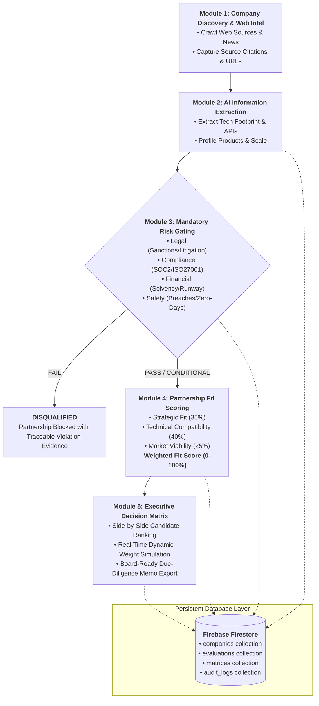

# PARTNERIQ — AI-Powered Partnership Intelligence Platform

> **An enterprise AI platform that automates partner due-diligence, extracts company capabilities and technology architectures from web sources, enforces mandatory risk gating, and scores partnership fit with dynamic executive decision matrices.**

---

## 🏛️ System Architecture & Workflow



---

## ⚡ Tech Stack

- **Frontend**: React 19, Tailwind CSS v4, Lucide React Icons, Vite
- **Backend**: Python 3.12, FastAPI, Uvicorn, BeautifulSoup4, DuckDuckGo Search, Pydantic v2
- **Database**: Firebase (Google Cloud Firestore via `firebase-admin` with local persistent JSON fallback)

---

## 📦 Functional Modules (End-to-End Split-Up)

### **Module 1 — Company Discovery & Web Intelligence**
- **Autonomous Partner Discovery**: Search web sources for prospective partners based on industry keywords, technical capabilities, or company name.
- **Web Intelligence Crawler**: Harvests corporate meta, developer documentation, press notices, and risk disclosures.
- **Source Evidence Capturing**: Every extracted fact maintains strict provenance, storing:
  - Source Title & Original URL
  - Direct Quote Snippet
  - Verification Confidence Score (0.80 - 0.99)
  - Audit Timestamp

### **Module 2 — AI Information Extraction**
- **Entity Attributes**: Extracts company overview, founding year, headquarters, headcount bracket, funding stage/valuation, and business model.
- **Deep Tech Stack Analysis**:
  - Cloud Platforms (AWS, GCP, Azure, Multi-cloud)
  - API Interfaces (RESTful JSON, GraphQL, gRPC, Webhooks, Websockets)
  - Official SDKs (Node.js, Python, Go, Java, Swift, Kotlin, etc.)
  - Architecture highlights (Microservices, Edge Runtime, Columnar Storage)
  - Security Certifications (SOC 2 Type II, ISO 27001, HIPAA, PCI-DSS)
- **Product & Ecosystem Mapping**: Product lineup, customer targets, and pre-built enterprise integrations.

### **Module 3 — Mandatory Risk Validation & Gating**
- **4 Mandatory Risk Pillars**:
  1. **Legal & Sanctions Risk**: Prohibits companies under active international sanctions, federal fraud inquiries, or prohibitive antitrust injunctions.
  2. **Financial Solvency Risk**: Evaluates cash runway, funding stage (Series A+, Public, or Cashflow Positive), and counterparty credit.
  3. **Compliance Risk**: Enforces verified SOC 2 Type II or ISO 27001 audit standards and GDPR compliance.
  4. **Safety & Breach Risk**: Verifies zero unmitigated critical CVEs (CVSS > 9.0) or active data breaches in the past 12 months.
- **Gating Verdict**:
  - `PASS`: Eligible for executive fit scoring.
  - `FAIL`: Flagged as **DISQUALIFIED**. The company cannot be recommended regardless of fit score, preventing dangerous partnerships.

### **Module 4 — Partnership Fit Scoring**
- Evaluates three quantitative pillars (0–100%):
  1. **Strategic Fit**: Business objective alignment, mutual customer overlap, co-selling potential, ecosystem synergy.
  2. **Technical Compatibility**: API maturity, SDK coverage, latency SLAs, architectural harmony.
  3. **Market Viability**: Brand reputation, market momentum, competitive moat, customer review sentiment.
- **Dynamic Configurable Weights**:
  - Dynamic sliders auto-normalize to 100% (default: 35% Strategic / 40% Technical / 25% Market).
  - Instant recalculation of the composite **Weighted Fit Score (0–100%)**.
  - Tier Classification: Tier 1 Strategic Alliance, Tier 2 Commercial Partner, Tier 3 Ecosystem Partner, or Disqualified.

### **Module 5 — Executive Decision Matrix**
- **Side-by-Side Candidate Ranking**: Compare multiple candidate partners simultaneously.
- **Live Dynamic Weight Adjustment**: Adjust priority sliders directly inside the Matrix to watch candidate rankings dynamically shift in real time.
- **Evidence Audit Inspector**: Click any cell or citation count to view raw quotations, verified links, and confidence indexes.
- **Executive Due-Diligence Dossier**: One-click generation of printable board-ready decision memos with printable view (`window.print()`) and JSON export.

---

## 🚀 Getting Started

### 1. Launch Everything with 1-Click (Windows)
Double-click `start_all.bat` or run:
```powershell
.\start_all.bat
```
This automatically starts the backend API on port 8000, the React frontend on port 5173, and opens your browser.

---

### 2. Manual Startup

#### Backend (FastAPI + Firebase)
```powershell
cd backend
python -m uvicorn main:app --host 127.0.0.1 --port 8000 --reload
```
- API Documentation (Swagger UI): `http://127.0.0.1:8000/docs`

#### Frontend (React + Vite + Tailwind CSS)
```powershell
cd frontend
npm run dev
```
- Web Application: `http://127.0.0.1:5173`

---

## 🗄️ Firebase Database Configuration

PartnerIQ is built to run effortlessly with Firebase:
- **Default Mode**: Runs on a local Firestore-compatible persistent JSON document store (`backend/data/firestore_local_db.json`), which matches Google Cloud Firestore collection & document semantics 1:1.
- **Live Google Cloud Firestore**: To connect your live cloud instance:
  1. Place your Google Cloud service account JSON at `backend/firebase_credentials.json`, OR
  2. Add `FIREBASE_PROJECT_ID=your-project-id` to `backend/.env`.
  3. Restart the backend server. The UI badge will immediately reflect **Firebase Live**.

---

## 🧪 Pre-Seeded Benchmark Candidates

The system comes pre-loaded with realistic enterprise candidate partners:
1. **Stripe** — FinTech / Payment Infrastructure (High Strategic & Technical Fit, Passed all gates)
2. **Datadog** — DevOps / Cloud Observability (Top Technical Leader, Passed all gates)
3. **Auth0 (by Okta)** — Identity & Access Management CIAM (Passed all gates)
4. **Snowflake** — Cloud Data Platform (Passed all gates)
5. **Supabase** — Open Source BaaS / Postgres (High Growth, Passed all gates)
6. **OmniShield Security (Legacy Risk Case)** — Configured to demonstrate Module 3 Risk Gating with **FAIL / DISQUALIFIED** status due to active export sanctions and missing SOC 2 certification.

You can also discover and analyze **any custom company or domain** in real-time from the Module 1 Discovery tab!
